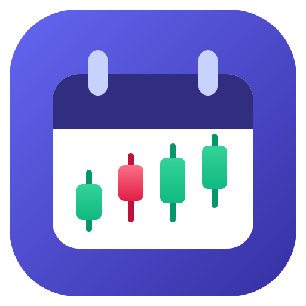
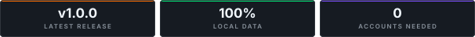

<div align="center">

  <a href="https://github.com/damsarachethiyaa-dev/Daybook">
    
  </a>

  # Daybook

  ### Desktop App — Windows 10 & 11

  **Track every trade. See your month at a glance.**  
  *A local-first trading journal & P&L calendar with an economic news feed • no account • no cloud.*

  <br />

  <p>
    <a href="https://github.com/damsarachethiyaa-dev/Daybook/releases/latest"></a>
    &nbsp;
    <a href="https://damsarachethiyaa-dev.github.io/github-portfolio/#projects"></a>
  </p>

  <p>
    
    &nbsp;
    
    &nbsp;
    
    &nbsp;
    
  </p>

  <p>
    <a href="https://github.com/damsarachethiyaa-dev/Daybook/releases">
      
    </a>
  </p>

  <p>
    
  </p>


</div>

<br />

---

## ✨ What is Daybook?

**Daybook** is a desktop trading journal that turns your trading history into a color-coded calendar — 🟢 green days for profit, 🔴 red days for loss — so you can *see* your consistency (or your tilt) at a glance.

Everything runs **100% on your machine**. No account, no cloud, no subscription, no telemetry. Your trading data never leaves your PC.

---

## 📸 Screenshots

### 📅 The P&L Calendar
Green = profitable day · Red border + 🔒 = locked past days · Glowing cell = today · Red badges = high-impact news count


### 📊 The Trade Log
Every trade in one sortable table — date, symbol, side, size, prices, fees, and P&L


### 📰 The Economic Calendar
This week's market-moving events with 🔥 impact ratings, forecasts, and your local times


---

## 🚀 Features

### 📅 Monthly P&L Calendar
- Every trading day is **color-coded by profit/loss** with daily stats: P&L, volume, trade count, win/loss record
- 🔒 **Smart date locking** — only *today* is open for journaling; past days lock automatically at midnight (with a red lock), future days can't be touched
- ✨ Today's cell **glows** with your accent color (GPU-optimized — buttery smooth)
- 🏷️ Tag pills and 📝 note indicators visible right on the calendar

### ✍️ Flexible Trade Entry
Two ways to log a trade — pick whichever fits your style:
| Mode | How | Best for |
|------|-----|----------|
| 💰 **Profit-only** | Type your P&L directly (e.g. `250` or `-120`) — done | Fast journaling, prop-firm traders, forex/gold |
| 🧮 **Full details** | Quantity + entry + exit + fees → P&L calculated automatically | Detailed record-keeping |

- Long 🟩 / Short 🟥 sides, fees tracking, live P&L preview as you type
- 🎉 **Confetti explosion** when you log a winning trade (you earned it)

### 📰 High-Impact News Integration
- Pulls the **ForexFactory weekly economic calendar** — CPI, rate decisions, NFP, central-bank speeches
- 🔴 **Pulsing red badges** on calendar days with high-impact events (🟠 orange for medium)
- Dedicated **News view**: events grouped by day, 🇺🇸🇬🇧🇪🇺 country flags, forecast vs. previous values, times in *your* timezone
- 🔄 **Auto-refreshes hourly** and rolls over at midnight — fresh events appear on their own
- Works offline too — last loaded events are cached

### 📊 Stats That Keep You Honest
- 📈 **Month P&L** with a smooth animated count-up
- 🎯 **Win rate** and trade count per month
- 🔥 **Win-streak chip** — consecutive green days, with an animated fire gradient

### 🎨 Make It Yours
- 🌙 **Dark** & ☀️ **Light** mode (follows your Windows setting by default)
- 🎨 **6 accent colors** — Indigo, Blue, Emerald, Rose, Amber, Violet — recolor the whole app in one click
- ♿ Respects Windows' *reduced motion* accessibility setting

### 💾 Bulletproof Local Storage
- Every trade, note, and tag is written **immediately and atomically** to a JSON file on your disk
- Survives crashes, force-closes, and power cuts
- 📦 **Backup = copy one file**: `%APPDATA%\daybook\daybook-data.json`

---

## 📥 Installation

### Option 1 — Installer (recommended)
1. Grab **`Daybook-Setup-0.1.0.exe`** from [Releases](../../releases) (or build it yourself below)
2. Run it, pick an install folder, done — Start Menu & desktop shortcuts included

### Option 2 — Portable
Use `release/win-unpacked/Daybook.exe` directly — no installation required.

---

## 🛠️ Building from Source

**Prerequisites:** [Node.js](https://nodejs.org/) 20+ and npm

```bash
# 1. Clone
git clone https://github.com/damsarachethiyaa-dev/Daybook.git
cd Daybook

# 2. Install dependencies
npm install

# 3. Run in development (hot reload)
npm run dev

# 4. Build the Windows installer
npm run dist:win
# → release/Daybook-Setup-0.1.0.exe
```

### All scripts

| Command | What it does |
|---------|--------------|
| `npm run dev` | 🔧 Dev mode — opens the app with hot reload |
| `npm run build` | 📦 Compile main / preload / renderer |
| `npm run dist:win` | 🚀 Build + package the Windows installer (NSIS) |
| `node scripts/generate-icon.mjs` | 🎨 Regenerate `build/icon.ico` from `build/icon.svg` |

---

## 🧱 Tech Stack

| Layer | Tech |
|-------|------|
| 🖥️ Shell | [Electron](https://www.electronjs.org/) 31 |
| ⚛️ UI | [React](https://react.dev/) 18 + [TypeScript](https://www.typescriptlang.org/) 5 |
| 🎨 Styling | [Tailwind CSS](https://tailwindcss.com/) 3 (runtime-swappable accent palette via CSS variables) |
| ⚡ Tooling | [electron-vite](https://electron-vite.org/) + [Vite](https://vitejs.dev/) 5 |
| 📦 Packaging | [electron-builder](https://www.electron.build/) (NSIS installer) |
| 💾 Data | Local JSON file (atomic writes) + localStorage cache — **no server, no database** |
| 📰 News | [ForexFactory](https://www.forexfactory.com/) weekly calendar feed (free, no API key) |

---

## 📁 Project Structure

```
Daybook/
├── build/                  # App icon (SVG source → ICO/PNG)
├── scripts/                # Icon generator
├── src/
│   ├── main/               # Electron main process (window, news fetch, file storage IPC)
│   ├── preload/            # Secure bridge between main ↔ renderer
│   └── renderer/src/
│       ├── components/     # Calendar, DayCell, TradeForm, TradeLog, News, Sidebar…
│       ├── services/       # newsService (fetch, cache, impact parsing)
│       ├── storage/        # tradeStore (CRUD + durable file persistence)
│       ├── theme/          # Dark/light mode + accent color system
│       └── utils/          # Calendar math, confetti 🎉, tag colors
└── release/                # Packaged .exe output (after dist:win)
```

---

## 🔐 Data & Privacy

- ✅ **Everything is local.** Trades, notes, tags, and settings live on *your* PC only
- 📄 Journal data: `C:\Users\<you>\AppData\Roaming\daybook\daybook-data.json`
- 🌐 The **only** network request Daybook ever makes is fetching the public news feed
- 💾 **Backup**: copy that one JSON file. **Restore**: put it back. That's it

---

## ⚠️ Good to Know

- 📰 The news feed covers the **current week only** (that's what the free feed provides) — past/future months won't show event badges
- 🗓️ Only **today** can be journaled from the calendar — that's by design, to keep the journal honest. The Trade Log still lets you add a past-dated trade if you forgot to log one
- 🖥️ Windows only for now (macOS/Linux would need their own build targets)

---

## 🗺️ Roadmap Ideas

- [ ] 📈 Week / Year calendar views
- [ ] 📤 CSV import from brokers
- [ ] 🧮 R-multiple & risk tracking
- [ ] 📊 Equity curve & analytics dashboard
- [ ] 💾 In-app backup / export button
- [ ] 🌍 Multiple trading accounts

---

## 📄 License

No license has been chosen yet — all rights reserved by the author for now.

---

## 👤 Author

- **Developer:** [Chethiya Rathnasekara](https://github.com/damsarachethiyaa-dev)
- **Repository:** [https://github.com/damsarachethiyaa-dev/Daybook](https://github.com/damsarachethiyaa-dev/Daybook)

---

<div align="center">

**Built with ❤️ (and a lot of ☕) for traders who journal.**

🟢 *Plan the trade. Trade the plan. Journal the result.* 🟢

</div>
